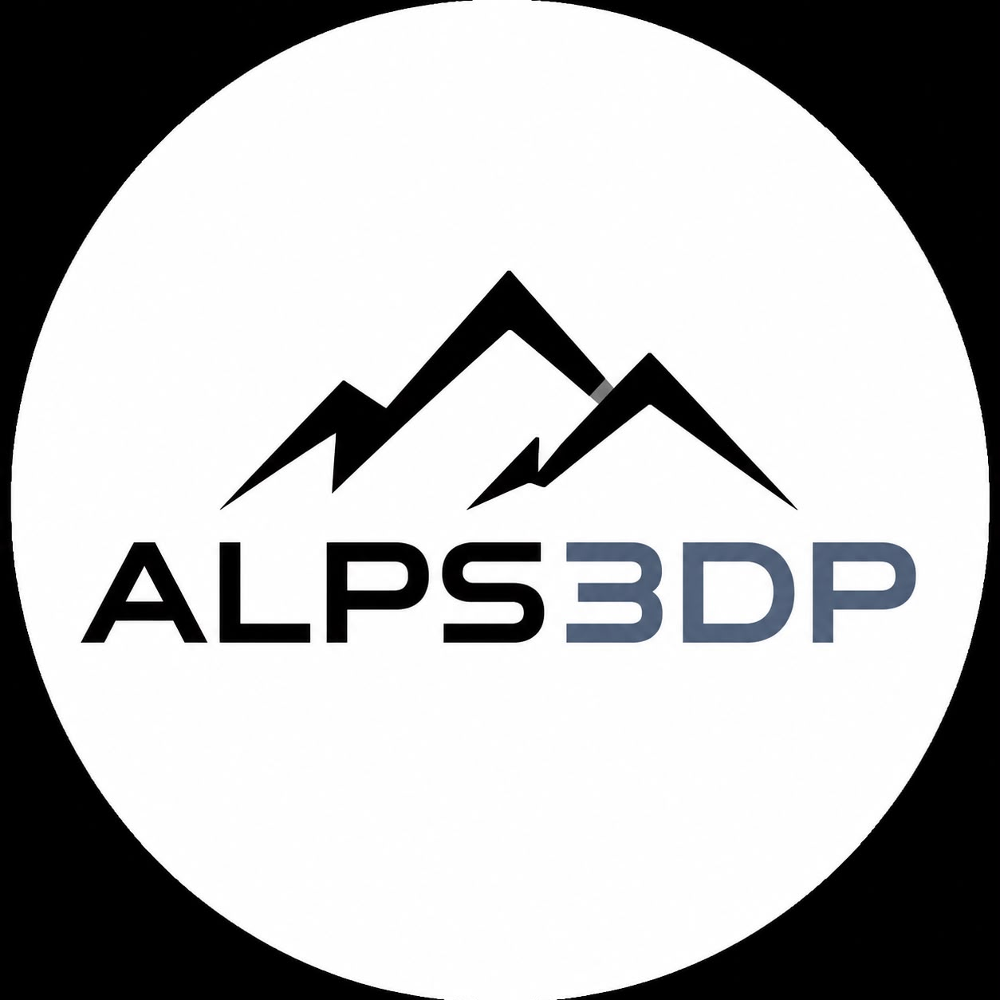

# Code of Conduct

Alps3Dp is built by people with different backgrounds, roles, and levels of experience. We expect all collaboration to be respectful, constructive, and professional.

In practical terms, this means discussing ideas without personal attacks, giving feedback in good faith, and keeping conversations focused on improving the product. It also means avoiding discriminatory language, harassment, intimidation, or any behavior that makes participation unsafe for others.

Maintainers are responsible for enforcing this code of conduct and may remove comments, reject contributions, or restrict participation when behavior violates these expectations.

If you experience or witness unacceptable behavior in issues, pull requests, discussions, or related project spaces, contact the maintainers privately so the situation can be reviewed and handled appropriately.

By participating in Alps3Dp, you agree to follow this code of conduct.
