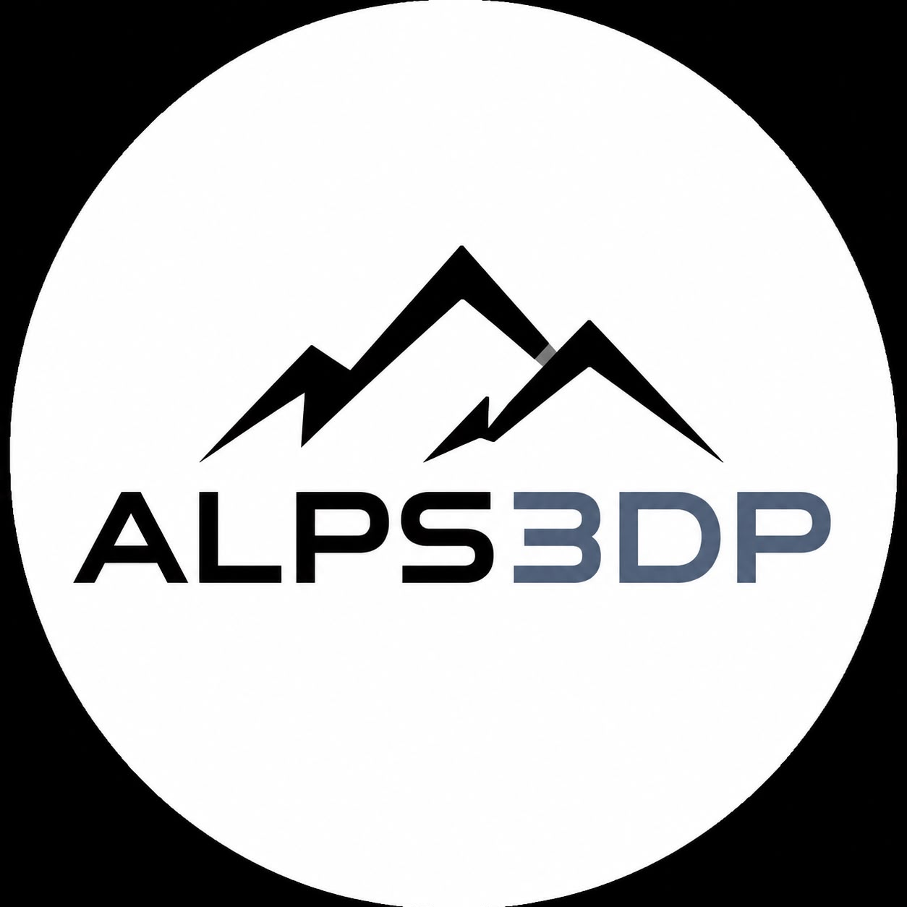

# Contributing to Alps3Dp

Thank you for contributing to Alps3Dp.

This project values focused, understandable changes. A good contribution improves one thing at a time, keeps behavior predictable, and leaves the repository easier to maintain than before.

Before opening a pull request, please run the project locally and confirm that your change behaves as expected. Start by installing dependencies with `npm install`, copy `.env.example` to `.env.local`, and prepare the database with `npm run db:generate`, `npm run db:migrate`, and `npm run db:seed`. During development, use `npm run dev` and verify type safety with `npm run typecheck`. For changes to registration, password recovery, support, Stripe webhooks, email routing or mail templates also run `npm run test:mail` and `npm run build`. These tests simulate provider and database behavior; they never send actual customer messages.

When you prepare a pull request, describe what changed, why it changed, and how you validated it. If your work affects user behavior, API responses, or deployment setup, update the related documentation in the same pull request. Maintain `CHANGELOG.md`, `README.md`, `docs/MAIL_SETUP.md`, `docs/MAIL_VERIFICATION.md` and `PRODUCTION_CHECKLIST.md` whenever mail behavior or routing changes, rather than leaving outdated instructions behind.

Please avoid mixing unrelated refactors into feature or bug-fix branches. Smaller and clearly scoped pull requests are easier to review, safer to release, and faster to merge.

Never commit secrets, private keys, or production credentials. Local environment files are intentionally excluded from version control and should stay local.

By contributing to Alps3Dp, you agree to follow the standards described in `CODE_OF_CONDUCT.md`.
