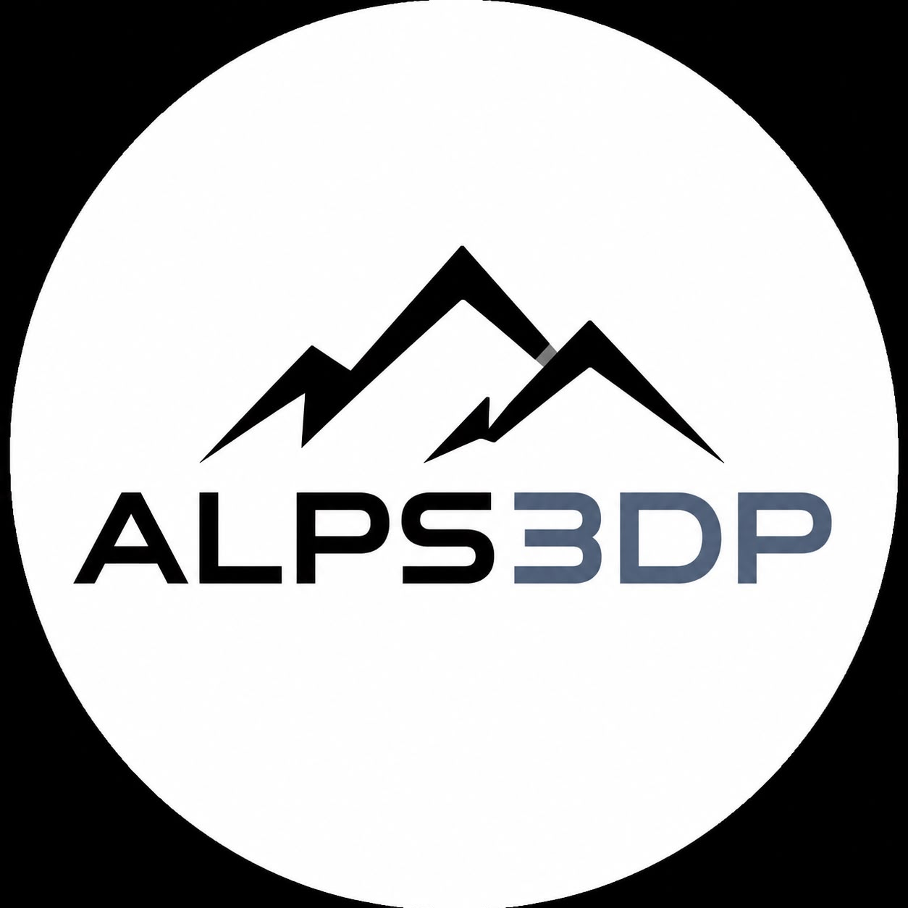

# Alps3Dp

Alps3Dp is an ecommerce website for 3D-printed products, designed to feel straightforward for customers and practical for operators. It combines product browsing, account management, checkout, payments, and order communication in one coherent flow.

The main goal of this repository is to provide a clean foundation for a real online shop. It is more than a UI prototype: it includes server routes, database models, payment integration, and transactional email handling, so the full order lifecycle can be tested and operated end to end.

## At A Glance

| Area | What It Covers |
| --- | --- |
| Storefront | Product browsing, responsive filters, ranked live search suggestions, detail pages, and cart actions |
| Checkout | Guest and account checkout with secure Stripe card payment |
| Orders | Persistent order records, Stripe webhook confirmation, and email follow-up |
| Admin | Product management, Stripe visibility, and controlled test utilities |
| Stack | Next.js, React, TypeScript, Prisma, PostgreSQL, Stripe, Tailwind |

## Built With

Alps3Dp uses Next.js 15 with the App Router, React 19, and TypeScript. Data is managed with Prisma and PostgreSQL. Payments are handled through Stripe Checkout and webhook events. Transactional emails are sent via SMTP or Resend, depending on your environment. Styling is implemented with Tailwind CSS, and deployment is prepared for Vercel.

## How The System Is Structured

The codebase is organized around clear responsibilities. `src/app` contains pages and API routes, `src/components` contains reusable UI building blocks, `src/lib` contains business logic and integration code, `prisma` contains schema and seed scripts, and `public` contains static assets, including the Alps3Dp logo used in the site navigation, browser favicon, and Apple touch icon. In practice, this keeps the storefront, checkout, payments, and admin tooling separated without making the project hard to understand.

## Local Setup

To run Alps3Dp locally, install dependencies with `npm install`, then create your local environment file by copying `.env.example` to `.env.local`.

After that, prepare the database with `npm run db:generate`, `npm run db:migrate`, and `npm run db:seed`. Once setup is complete, start the app with `npm run dev`.

The app will be available at `http://localhost:3000`.

## Payment And Email Flow

Checkout is available to signed-in customers and to anonymous guests: guests keep their cart in the browser (`src/lib/guest-cart.ts`) and provide shipping details directly at checkout, while signed-in customers can reuse saved addresses. Payment is accepted securely through Stripe Checkout by credit or debit card; there is no manual invoice option.

Checkout sessions are created server-side in `src/app/api/checkout/route.ts`. Payment completion is accepted only after Stripe webhook verification in `src/app/api/webhooks/payment/route.ts`, which checks the paid amount and currency before marking an order as paid. A shopper returning from a cancelled Checkout has the matching open session expired server-side; admin pages also reconcile pending orders against Stripe if webhook delivery was missed. Revenue reports count paid Stripe orders (including orders later marked shipped), and do not mix in failed, pending, or test orders.

The storefront search ranks live suggestions across product titles, descriptions, and categories as the customer types. Light and dark appearance follows the device setting until the customer explicitly chooses a theme; reduced-motion settings use a short static intro instead of suppressing the intro entirely.

For environments that use both preview and production domains, Alps3Dp now resolves Stripe redirect URLs from the active request host when possible. This reduces the risk of a working Stripe setup being misread as broken simply because `APP_URL` still points at an older Vercel or preview domain.

Email delivery is handled in `src/lib/mail.ts` using Resend (preferred with `RESEND_API_KEY`) or explicitly configured SMTP. The shared template is intentionally minimal, using the **same Alps3Dp logo as the website** (`/images/logo.jpeg`), a white layout, readable typography and concise order/account details. Every message includes HTML and plain text. Provider rejections are detected rather than treated as successful sends.

**Shop notifications:** Customer order confirmations go to the purchasing customer. Every paid-order notification and submitted contact enquiry is also independently sent to the designated shop manager, **`Alp.Kasemi@alps3Dp.ch`**, even if `ADMIN_ORDER_EMAIL` or `MAIL_SUPPORT_EMAIL` is unset or different. Distinct configured operations/support mailboxes receive their own copies; duplicate addresses are suppressed. When no separate support mailbox is configured, the manager is also the default support contact. Failure of an optional support copy is logged without making a successfully received manager enquiry appear unsent to the customer. Password reset, login security and verification links are **never copied** to the manager.

See [Mail setup](docs/MAIL_SETUP.md) for DNS, verified sender addresses, provider diagnostics, safe delivery tests and current reliability limitations.

## Email verification and delivery

The transactional flows include registration welcome + verification, login security notices, password reset, account email verification, customer order confirmations, shop-manager order notifications, and contact-form requests and acknowledgments. Verification links can be requested again by signed-in users whose email is not confirmed. Password reset links are one-time and replace earlier pending reset links.

Source tests simulate these complete routes with in-memory fixtures and intercepted Resend responses; they never send real email or charge a card. Passing CI **does not prove** the custom sender domain is verified, Vercel has the correct secrets, Resend accepted live messages or the receiving mailbox delivered them.

See [mail configuration](docs/MAIL_SETUP.md), [verification report](docs/MAIL_VERIFICATION.md) and [release checklist](PRODUCTION_CHECKLIST.md). The two Copilot findings from PR #3 (concurrent verification replacement and concurrent password-reset token creation) were fixed using database transactions and per-user row locks. Current tests cover both types of token serialization; see [changelog](CHANGELOG.md).

## Production Readiness

Alps3Dp includes rate limiting, input validation, role checks for admin routes, and Stripe webhook signature verification. Recent hardening work also added input validation for checkout email addresses, stronger webhook checks for amount and payment status, safer upload file validation based on binary signatures, and better Stripe diagnostics when a webhook is registered on the correct endpoint path but a different domain. **Email verification is currently not enforced at checkout**; the former check is commented out in the checkout route.

For production rollout, secrets must stay in Vercel environment settings and never be committed to Git. Database migrations should be run intentionally, and deployment builds should not silently seed production data.

A practical release checklist is available in `PRODUCTION_CHECKLIST.md`.

## Scripts

The most relevant scripts are `npm run dev`, `npm run build`, `npm run start`, `npm run typecheck`, `npm run test:mail`, `npm run db:generate`, `npm run db:migrate`, and `npm run db:seed`. GitHub Actions runs mail tests, typechecking and an isolated production build on affected pull requests.

## Repository Documents

Project behavior and collaboration standards are documented in `CONTRIBUTING.md`, `SECURITY.md`, `CODE_OF_CONDUCT.md` and `CHANGELOG.md`. Email-specific references are `docs/MAIL_SETUP.md` and `docs/MAIL_VERIFICATION.md` with the end-to-end checklist in `PRODUCTION_CHECKLIST.md`.

## License

Alps3Dp is released under the MIT License. See `LICENSE` for details.

### Transactional email sender identities

Account creation, verification, login and password recovery use `MAIL_FROM_ACCOUNT` (default `Alps3Dp <info@alps3dp.ch>`); contact messages and confirmations use `MAIL_FROM_SUPPORT` (default `Alps3Dp <info@alps3dp.ch>`); order confirmations and operator notices use `MAIL_FROM_ORDER` (default `Alps3Dp <order@alps3dp.ch>`). Legacy `MAIL_FROM` remains an order-only fallback. Recipient routing is separate: `Alp.Kasemi@alps3Dp.ch` still receives management notifications. See `docs/MAIL_SETUP.md`.
